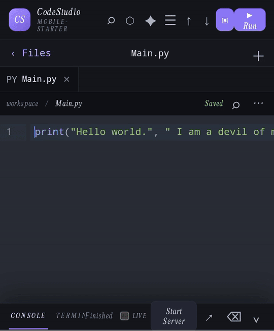

# 🚀 CodeStudio Mobile

<p align="center">
  
</p>

<p align="center">
  <strong>An offline-first mobile coding workspace for developers.</strong>
</p>

<p align="center">
  CodeMirror Editor • Project Explorer • Local Storage • JavaScript Runner • Python Runtime • HTML Preview • AI Agents
</p>

---

## 🎬 Live Demo

CodeStudio Mobile brings a powerful coding workspace directly to Android.

The demo above shows the application running in real time, including the editor and development workflow.

> ⚡ No installation is required to view the demo.

---

## ✨ What is CodeStudio Mobile?

**CodeStudio Mobile** is an offline-first mobile coding workspace designed for writing, editing, running and previewing code directly on an Android device.

It combines a modern **CodeMirror editor**, local project management, JavaScript and Python execution, HTML preview, syntax diagnostics, learning tools and optional AI coding agents into one mobile development environment.

---

## 🔥 Key Features

### 💻 Advanced Code Editor

- CodeMirror-based editor
- Syntax highlighting
- Language-aware completion
- Bracket matching
- Automatic indentation
- Line numbers
- Syntax diagnostics
- Multiple open tabs
- Adjustable editor text size
- Dark and light themes

### 📁 Project Management

- Multiple locally saved workspaces
- Recent-project switching
- Rename projects
- Duplicate projects
- Delete projects
- Nested file and folder management
- Starter templates
- Import/export projects
- Local project snapshots
- Branch creation
- Changed-path comparison
- Save and restore snapshots

### ▶️ Code Execution

- JavaScript execution through a short-lived Worker
- Offline Python 3.14 runtime
- Pyodide WebAssembly runtime
- Fresh Python environment for every run
- Execution timeout protection
- `hello.py` starter example

### 🌐 HTML Preview

- Automatically detects `index.html`
- HTML/CSS/JavaScript preview
- Live refresh
- Restricted preview iframe
- Workspace-based dependency resolution
- Android loopback Live Server
- Start/Stop Live Server
- Browser chooser

### 🧪 Developer Panels

- Console
- Limited workspace-action Terminal
- Problems panel
- Debug execution trace
- HTML Preview
- Worker/Preview diagnostics

### 📚 Learning Tools

- Guided offline Python exercises
- Automatic output checks
- Project-wide Find & Replace
- Safe whitespace tidy
- Adjustable editor text
- Dark/light application themes

### 🤖 AI Coding Agents

CodeStudio includes optional AI agents powered through an OpenAI-compatible backend.

#### Ask

Ask coding questions and receive programming assistance.

#### Build

Generate complete file changes as a reviewable proposal.

AI-generated changes are **not automatically applied**. You review the proposed changes and tap **Apply** when you are ready.

---

# 🧠 Supported Languages

CodeStudio currently provides editor support for:

```text
JavaScript
TypeScript
JSX
TSX
HTML
CSS
JSON
Python
Java
C
C++
Rust
Go
SQL
PHP
XML
YAML
Markdown
Angular
WAST
Lezer